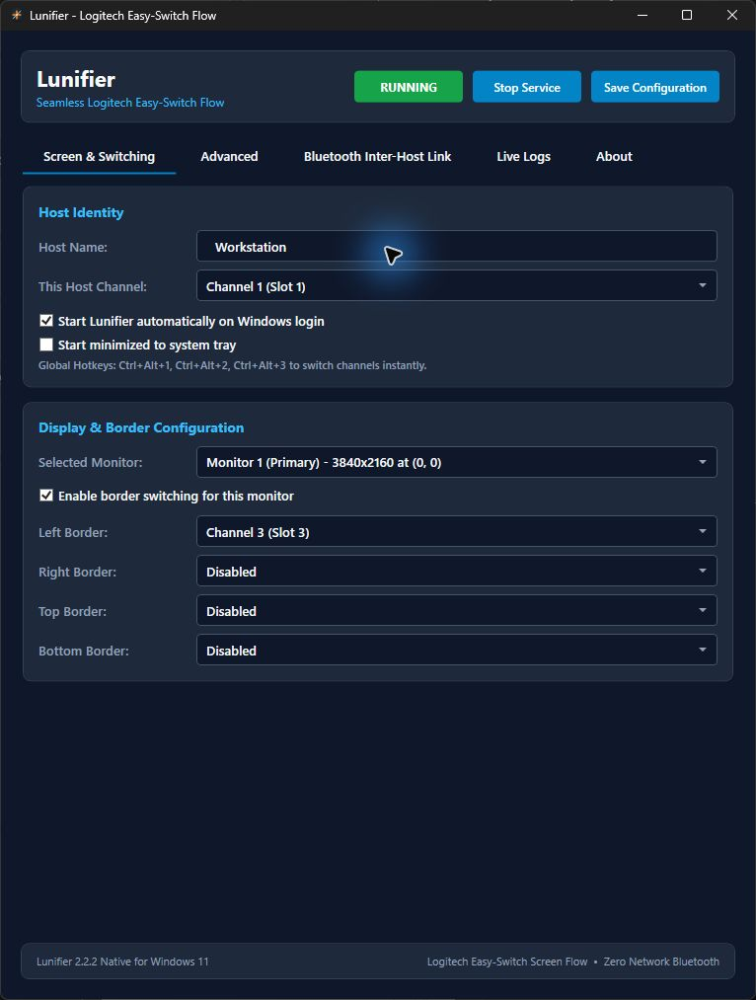
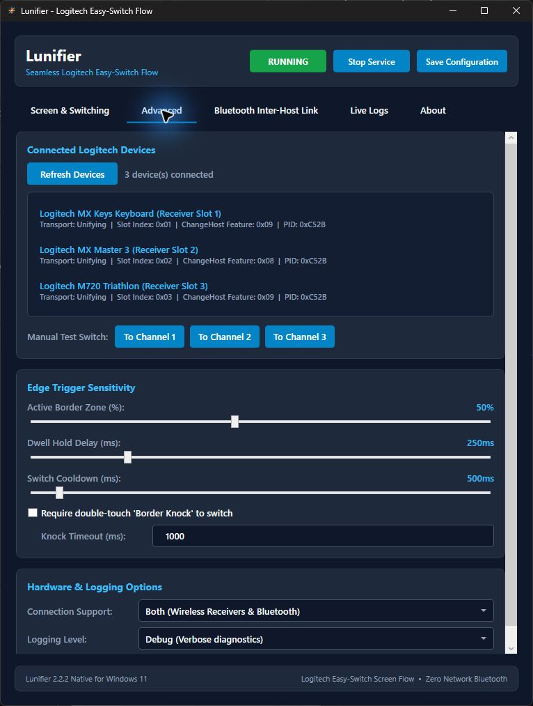
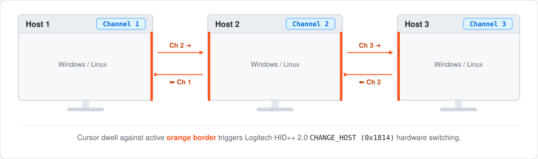

[**Website & downloads ↗**](https://silviuk.github.io/Lunifier/) · [Latest release](https://github.com/silviuk/Lunifier/releases/latest)

# Lunifier

Move your mouse to the edge of the screen to switch your Logitech keyboard and mouse to another computer. Lunifier uses their Easy-Switch channels, so your computers don’t need to share a Wi-Fi or LAN connection.

**Windows + Linux · Logitech Easy-Switch**

## What you can do

- **Pick an edge for each computer.** Choose which computer sits beyond each screen edge by assigning its Easy-Switch channel: 1, 2, or 3.
- **Use an edge, a hotkey, or the tray.** Switch from a screen edge, a keyboard shortcut, or the tray menu. Adjust how long to wait at an edge and between switches to avoid switching by accident.
- **No shared network needed.** Each computer can switch the devices on its own. If you also want to align the cursor position or share text from the clipboard, you can turn on the optional Bluetooth link.

## Screenshots

*Configure screen edges, host channels, and switching shortcuts.*

*Detect devices and adjust switching behavior.*

## How switching works

Each computer has its own Easy-Switch channel. Move to a highlighted edge to switch your keyboard and mouse to the next computer.

## Get started

1. Pair your compatible keyboard and mouse with each computer on its own Easy-Switch channel.
2. Install Lunifier on each computer, then select the Easy-Switch channel you paired it with.
3. Assign screen edges to the other channels, then move to an edge to switch.

### Debian / Ubuntu

Download the latest `.deb` from Releases, or use the [APT installation instructions](https://silviuk.github.io/Lunifier/#installation).

## Before you start

A Windows or Linux computer for each host, compatible Logitech Easy-Switch peripherals, and Bluetooth, Unifying, or Logi Bolt connections supported by your devices. Pair the devices with every host before configuring Lunifier.

Your devices need to support HID++ Easy-Switch commands. The optional Bluetooth link is off by default. Lunifier is an independent project and isn’t affiliated with Logitech.

## More information

[Configuration reference](docs/CONFIGURATION.md) and [source build instructions](docs/DEVELOPMENT.md). The current native Windows source is maintained on the [2.0 branch](https://github.com/silviuk/Lunifier/tree/2.0).

Something not working, or have a suggestion? [Open an issue](https://github.com/silviuk/Lunifier/issues). If you’d like to support my work, [you can leave a tip on Ko-fi](https://ko-fi.com/silviuvlasceanu).

© 2026 Silviu Vlasceanu. [License](LICENSE).
